Five tracks are my commits, sorted by what I was building. The last one, techno, is reported by the machine itself every 30 minutes. If it goes red, the machine is off.

[**kiki**](https://github.com/lkyxuan/kiki) · [**SignalStudio**](https://github.com/lkyxuan/SignalStudio) · [**lkyx**](https://github.com/lkyxuan/lkyx) · [X @0xmiracle](https://x.com/0xmiracle)
